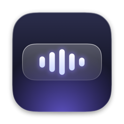
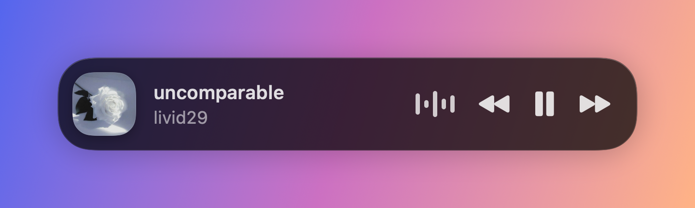
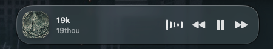

<div align="center">



# Dynamic Dock

**A floating music dock for macOS.**
Touch the bottom edge of your screen and your music slides up.


[**Download the latest release**](https://github.com/sjdsjadjajdjsa/DynamicDock/releases/latest)



<sub>Design render.</sub>



<sub>Screenshot on a real desktop, with Liquid Glass (macOS 26 and later).</sub>

</div>

## Features

- **Hidden until you want it.** The dock lives off screen and springs up when
  your cursor rests on the bottom-centre edge, like the macOS Dock.
- **Now playing at a glance.** Track title, artist and album artwork from
  Spotify or Apple Music, updated the moment the song changes.
- **Playback controls.** Play, pause, skip and go back without switching apps.
- **Animated visualizer.** Five bars that move while music plays and settle
  into dots when it pauses.
- **Native look.** Liquid Glass, continuous corners, spring animations and
  scrolling text for long titles.
- **Stays out of the way.** No Dock icon, never steals keyboard focus, works
  over full-screen apps and on every Space, and uses no CPU while hidden.

## Install

Requires macOS 14 or later. The Liquid Glass look needs macOS 26 or later;
earlier versions use standard vibrancy.

1. Download `DynamicDock.zip` from the
   [latest release](https://github.com/sjdsjadjajdjsa/DynamicDock/releases/latest),
   unzip it and move `DynamicDock.app` to your Applications folder.
2. The app is not notarized by Apple, so macOS blocks it the first time.
   Remove the download quarantine flag in Terminal:

   ```sh
   xattr -dr com.apple.quarantine /Applications/DynamicDock.app
   ```

   Alternatively, try to open the app once, then go to System Settings →
   Privacy & Security and click **Open Anyway**.
3. Open the app. A music-note icon appears in the menu bar.
4. When Spotify or Music is running, macOS asks whether Dynamic Dock may
   control it. Click **Allow**. Without it the dock still shows the track
   name, but artwork and the buttons do not work.

If you clicked Don't Allow, turn it on under System Settings → Privacy &
Security → Automation → Dynamic Dock.

## Usage

| To | Do this |
|---|---|
| Show the dock | Rest the cursor on the bottom edge of the screen, near the centre |
| Hide the dock | Move the cursor away |
| Change settings | Click the music-note icon in the menu bar → Settings |
| Quit | Click the music-note icon in the menu bar → Quit |

Settings let you open the app at login, reveal the dock from the entire
bottom edge, and tune how quickly it appears and hides.

If your macOS Dock is also at the bottom with auto-hide on, both appear
together. Moving the macOS Dock to the left or right avoids that.

## Build from source

Needs the Xcode Command Line Tools (`xcode-select --install`). Xcode itself is
not required.

```sh
git clone https://github.com/sjdsjadjajdjsa/DynamicDock.git
cd DynamicDock

Scripts/build-app.sh          # builds build/DynamicDock.app for this Mac
open build/DynamicDock.app

Scripts/package.sh            # universal build, zipped as build/DynamicDock.zip
```

The build is ad-hoc signed, so macOS asks for the Spotify/Music permission
again after each rebuild. To avoid that, sign with a certificate:
`SIGN_IDENTITY="Your Certificate Name" Scripts/build-app.sh`.

## How it works

| Part | Approach |
|---|---|
| Window | A borderless, non-activating `NSPanel` at status-bar level that joins every Space |
| Edge trigger | Global and local `NSEvent` mouse monitors; no Accessibility permission needed |
| Track info | Distributed notifications posted by Spotify and Music, so nothing is polled |
| Controls and artwork | Apple Events, sent only to players that are already running |
| Visualizer | Core Animation layers animated by the system render server |
| Interface | SwiftUI hosted in AppKit |

The source is organised as `App`, `Windowing`, `Media`, `UI` and `Settings`
under `Sources/DynamicDock`.

## Privacy

The app makes one kind of network request: downloading album artwork from
Spotify's image server. It collects nothing.

## License

[MIT](LICENSE)
